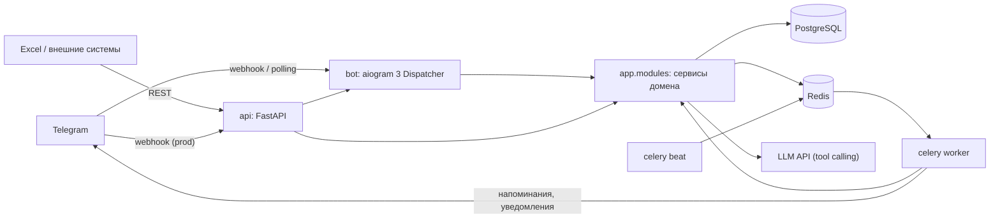

# DOMIK CRM — Архитектура

## 1. Стиль: модульный монолит + отдельные воркеры

Один репозиторий и одна кодовая база, но **несколько процессов**:



| Процесс | Команда | Назначение |
|---|---|---|
| `api` | `uvicorn app.main:app` | REST + OpenAPI, приём Telegram webhook в prod |
| `bot` | `python -m app.bot.main` | long polling для локальной разработки |
| `worker` | `celery -A app.worker worker` | уведомления, напоминания, Excel sync, лист ожидания |
| `beat` | `celery -A app.worker beat` | расписание периодических задач |
| `migrate` | `alembic upgrade head` | миграции при деплое |

**Почему монолит, а не микросервисы:** команда маленькая, домены тесно связаны (объект ↔ бронь ↔ клиент), а транзакции между ними должны быть атомарными (сдали объект → в той же транзакции отменили все просмотры). Модули изолированы, так что любой из них потом можно вынести в отдельный сервис.

## 2. Слои внутри модуля

```
app/modules/<module>/
├── models.py      # SQLAlchemy 2 ORM (Mapped[...])
├── schemas.py     # Pydantic v2 DTO — общие для API, бота и LLM tools
├── repository.py  # только запросы к БД
├── service.py     # бизнес-логика, не знает про Telegram/HTTP
├── router.py      # FastAPI endpoints (тонкий слой)
└── tasks.py       # Celery-задачи (тонкий слой)
```

Правило зависимостей: `bot/handlers`, `api`, `tasks` → `service` → `repository` → `models`.
Сервисы получают `AsyncSession` снаружи; **commit выполняется на границе** (middleware бота, зависимость FastAPI, Celery-задача).

## 3. Ключевые решения по задачам ТЗ

| Задача | Решение |
|---|---|
| **1. ИИ-подбор** | `AssistantService` — цикл tool calling: `search_properties`, `get_property_details`, `save_client_preferences`, `search_faq`, `handoff_to_operator`. Критерии клиента валидируются через Pydantic `PropertySearchCriteria`, поэтому LLM не может «сломать» запрос. История диалога хранится в Redis (TTL 24 ч). Если LLM недоступен, бот переходит на сценарий с кнопками. |
| **2. Excel ↔ CRM** | Ключ строки — `code`. При импорте сравниваются `updated_at` из файла и из БД: если объект изменили в CRM после последнего экспорта, приоритет у CRM, а конфликт попадает в отчёт. Beat-задача: импорт (только если изменился mtime файла) → экспорт. Владелец может загрузить `.xlsx` прямо в бот. |
| **3. Бронирования** | Защита от пересечений встреч агента сделана на уровне БД: `EXCLUDE USING gist (agent_id WITH =, tstzrange(starts_at, ends_at) WITH &&) WHERE status='scheduled'`. Гонку двух одновременных броней разрешает PostgreSQL, а не код. Агент выбирается по принципу «наименее загружен в этот день», при конфликте берётся следующий кандидат через SAVEPOINT. Генерация слотов — чистые функции (`scheduling.py`), покрытые unit-тестами. |
| **Напоминания** | Beat раз в минуту вызывает `send_due_reminders`: выбирает брони, до начала которых ≤ 15 мин, и ставит флаг `reminder_sent`. Это идемпотентно и переживает перезапуски. При переносе брони ничего не нужно отзывать (revoke), в отличие от `eta`-задач. |
| **Опоздание / перенос / отмена** | `extend()` сдвигает `ends_at` (exclusion constraint сам проверит конфликт), `reschedule()` сначала пробует того же агента, затем других. При отмене запускается `process_waitlist`. |
| **Очередь ожидания** | `waitlist_entries` (FIFO по `created_at`). Когда освобождается слот, первому в очереди приходит предложение с кнопкой «Забронировать». |
| **4. Статусы объектов** | `properties/workflows.change_property_status()` в одной транзакции меняет статус, отменяет брони и закрывает лист ожидания. После commit ставится Celery-задача, которая уведомляет клиентов и агентов и предлагает альтернативы (тот же район/тип, цена ±20%). |
| **5. Поддержка** | Tool `handoff_to_operator` создаёт `Ticket` с категорией, приоритетом, кратким резюме, критериями и транскриптом. Сотрудники получают карточку с кнопкой «Взять в работу» и отвечают клиенту через бот. |
| **6. Мультиязычность** | `app/locales/{ru,en,it}.json` + `I18nMiddleware` передаёт в хендлеры `t()`. Язык хранится в `users.language`. Системный промпт LLM требует отвечать на языке пользователя. Unit-тест следит, чтобы ключи всех локалей совпадали. |
| **7. Telegram CRM** | `RoleFilter` на уровне роутера `staff`. Роли: `owner`, `agent`, `client`. Владелец видит всё: статистику, Excel, агентов. Агент видит своё расписание и обращения. |

## 4. Инфраструктура и кросс-функциональные вещи

- **aiogram 3**: FSM в `RedisStorage`; middlewares: `Logging → DbSession → User → I18n → Throttling`; `CallbackData`-фабрики вместо строковых callback.
- **FastAPI**: `/api/v1/*`, авторизация по `X-API-Key`, `/health`, `/webhook/telegram` с проверкой `X-Telegram-Bot-Api-Secret-Token`.
- **structlog**: JSON в prod, цветной вывод локально; через contextvars в каждый лог попадают `update_id` и `user_id`.
- **Конфигурация**: `pydantic-settings`, все настройки задаются переменными окружения (`.env.example`).
- **Тесты**: `unit` (чистая логика, без внешних зависимостей), `integration` (настоящий Postgres), `e2e` (FastAPI через httpx `ASGITransport`).
